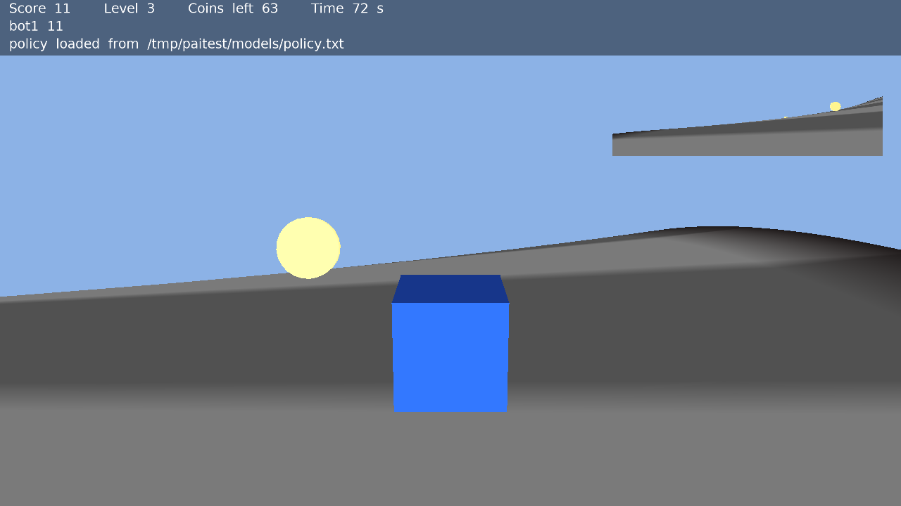
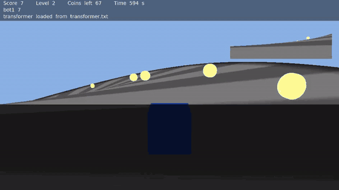
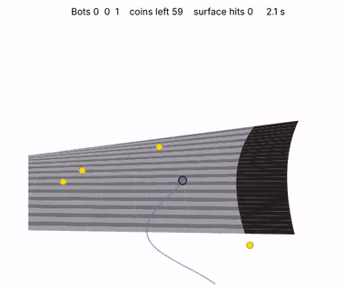

# Physical AI Simulation Training (2016)

Training a robot inside a virtual world before it ever touches the real one.

A bot in this project looks at the world through its own small camera, and a
neural network turns what it sees into driving commands. The network learns
from demonstrations inside a 3D graphics engine with physics, not on a road,
so a learning machine can make its mistakes where no vehicle is damaged and no
person is hurt: in bad weather, in traffic, in a crash.

**The cubes, coins and scores are not the point.** The project began in 2016 in
a Game Engineering course whose rule was that every project had to be a game,
so the idea was given a game's clothes: a cube for the robot, coins for goals,
a score for how well it does. Underneath, the subject is physical AI: robots and
self-driving vehicles trained in simulation (VR) and judged by what they do there.

The project grew out of an idea William H. Chuang brought to the course in 2016,
and it became real through the work of the whole team, Enrique Gonzalez and
Prof. David Galles, to whom he remains grateful. At the time, the team knew of no
comparable work; it was new to them, and it is shared here in that spirit.

| The restored 2016 simulation | The transformer bot (2026) | Free flight |
|---|---|---|
|  |  |  |

## Contents

- [At a glance](#at-a-glance)
- [Results](#results)
- [Quick start](#quick-start)
- [Repository map](#repository-map)
- [Variation 1: the restored 2016 simulation](#variation-1-the-restored-2016-simulation)
- [Variation 2: free flight](#variation-2-free-flight)
- [Transformer policies (2026)](#transformer-policies-2026)
- [2016 in context](#2016-in-context)
- [History](#history) · [Credits](#credits)

## At a glance

| | `/` Restored 2016 simulation | [`free-flight/`](free-flight/) |
|---|---|---|
| Body | a cube on the surface of the strip | a sphere moving freely in 3D above it |
| Senses | its own camera: a 20 x 20 grey image | the strip's frame, the nearest coins and the nearest other bot |
| Learns by | imitation: a demonstrator presses the keys, the network copies them | backpropagation through a differentiable simulator |
| Engine | C++17, Ogre 1.9, OIS, Lua 5.2 (as in 2016) | Python, PyTorch |
| Modes | train, demo, compare | train, demo, compare |
| Transformer (2026) | attention over the last 4 camera frames | attention over the last 8 observations |

Both variations ship with trained policies, the original network and a transformer,
so the demos run at once.

### The track

Every variation drives on a Möbius strip of radius R = 1000,

    X(u, v) = R ((1 + v cos(u/2)) cos u, (1 + v cos(u/2)) sin u, v sin(u/2)),   |v| <= 1/2,

a surface with one side: half a lap later the bot is on the "other" face, upside
down to an outside observer, so the controller must work in the strip's local
frame (across, up, forward) instead of a fixed world frame.

## Results

### Restored simulation: every controller, seeds 101, 202, 303

A 90-second demo round in the rendered game: one bot, 74 coins that do not come back.

| Controller | 101 | 202 | 303 | Mean |
|---|---|---|---|---|
| untrained network | 0 | 0 | 2 | 0.7 |
| driving straight, never steering | 3 | 6 | 4 | 4.3 |
| perceptron learned in the game (`models/policy.txt`), first test | 26 | 17 | 28 | 23.7 |
| same perceptron, retested with the fixed time step | 29 | 19 | 24 | 24.0 |
| perceptron retrained in PyTorch, round 0 | 33 | 32 | 28 | 31.0 |
| perceptron retrained, round 1 | 32 | 42 | 32 | 35.3 |
| perceptron retrained, round 2 (`transformer/models/policy-same-data.txt`) | 33 | 41 | 33 | 35.7 |
| transformer, round 0 | 34 | 40 | 36 | 36.7 |
| transformer, round 1 | 33 | 42 | 40 | 38.3 |
| **transformer, round 2** (`transformer/models/transformer.txt`) | **36** | **36** | **37** | **36.3** |
| the autopilot it learned from, which sees every coin | 62 | 51 | 71 | 61.3 |

The perceptron in `models/policy.txt` learned in the rendered engine from the
autopilot (`config/presets/train-autopilot.cfg`): about 18 minutes of driving,
about 20 decisions a second, with the network at the wheel half the time (DAgger).
It was chosen by this evaluation among the saved checkpoints; training on at the
same learning rate became unstable. Rounds 0 to 2 are the training rounds of the
2026 networks: round 0 learned from recorded autopilot driving, and in rounds 1
and 2 each network also drove part of the time while the autopilot labelled every
frame. Both networks always trained on the same recordings. The first test of the
original perceptron ran in real time, every later row with a fixed step of 1/30 s,
which gives the same result (23.7 and 24.0). The straight and autopilot rows come
from the same rules without rendering.

### Restored simulation: the shipped controllers, six seeds

| Controller | 101 | 202 | 303 | 404 | 505 | 606 | Mean |
|---|---|---|---|---|---|---|---|
| perceptron learned in the game, every 0.1 s | 29 | 19 | 24 | 19 | 21 | 19 | 21.8 |
| same perceptron, every 0.05 s | 12 | 19 | 15 | 7 | 28 | 15 | 16.0 |
| perceptron retrained on the recordings, every 0.05 s | 33 | 41 | 33 | 34 | 35 | 30 | 34.3 |
| **transformer**, every 0.05 s | **36** | **36** | **37** | **36** | **39** | **36** | **36.7** |

Most of the gain over the original perceptron comes from the recordings and the
DAgger rounds (21.8 → 34.3). On the same data the transformer adds 2.3 coins a
round (7 %), wins on five of six seeds and varies least (36 to 39).

### Free flight

Sixty seconds, 32 worlds with 4 bots each, coins do not come back; per bot and
minute. Learned policies: seeds 7, 8 and 9, all trained 100 episodes with the
same loss and seed. Untrained and cruise: seed 7.

| Controller | Coins | Surface hits | Bot-bot hits | Speed along the strip | Time outside the corridor |
|---|---|---|---|---|---|
| untrained network | 0.0 | 1.87 | 0 | 37 | 73 % |
| hand-written cruise (maximum thrust ahead, hold 40 above the middle) | 0.7 | 0 | 0 | 259 | 0 % |
| network 23 → 64 → 64 → 3 (`free-flight/models/flight_policy.pt`) | 4.25 | 0 | 0 | 275 | 0 % |
| transformer, memory of 1 observation (test only, not shipped) | 6.50 | 0 | 0 | 271 | 0 % |
| **transformer, memory of 8** (`transformer/free-flight/models/flight_transformer.pt`) | **7.04** | **0** | **0** | **270** | **0 %** |

The transformer collects 66 % more coins than the network and about ten times the
hand-written cruise, with no contact with the surface or between bots. With a memory
of a single observation it already reaches 6.50: most of the gain comes from the
transformer layers, and the memory of 8 adds about 8 %. Method and training records:
[`transformer/README.md`](transformer/README.md).

## Quick start

```sh
# Restored simulation. Linux packages: cmake g++ pkg-config libogre-1.9-dev libois-dev liblua5.2-dev
cmake -S . -B build && cmake --build build
./build/pai_tests                                   # 33 unit tests, no window
./build/pai_sim                                     # the 2016-style bot collects coins
./build/pai_sim transformer/config/demo.cfg         # the transformer bot
./build/pai_sim config/presets/compare.cfg          # you beside the bot

# Free flight (Python 3, PyTorch)
cd free-flight && pip install -r requirements.txt
python viewer.py demo --bots 3
python viewer.py demo --bots 3 --policy ../transformer/free-flight/models/flight_transformer.pt
```

## Repository map

<!-- tree:start -->
```text
physical-ai-sim-training-2016/
├── .github/          GitHub settings
│   └── workflows/    Continuous checks: README tree, core build and tests
│       └── checks.yml
├── config/           Game settings and ready-made presets
│   ├── presets/      Ready-made settings for each mode
│   │   ├── agent-view.cfg
│   │   ├── compare.cfg
│   │   ├── demo-three-bots.cfg
│   │   ├── evaluate.cfg
│   │   ├── README.md
│   │   ├── train-autopilot.cfg
│   │   └── train.cfg
│   ├── game.cfg
│   ├── plugins.cfg.in
│   └── README.md
├── docs/             Images for the README
│   ├── demo.png
│   └── README.md
├── free-flight/      Variation 2: free 3D flight over the strip, trained in PyTorch
│   ├── docs/         Demo clip of the trained bots
│   │   ├── demo.gif
│   │   └── README.md
│   ├── models/       Trained flight policy and its records
│   │   ├── flight_policy.eval.json
│   │   ├── flight_policy.history.json
│   │   ├── flight_policy.pt
│   │   └── README.md
│   ├── tests/        Tests of geometry, physics and gradients
│   │   ├── README.md
│   │   └── test_flight.py
│   ├── evaluate.py
│   ├── mobius.py
│   ├── policy.py
│   ├── README.md
│   ├── requirements.txt
│   ├── train.py
│   ├── viewer.py
│   └── world.py
├── media/            Materials and font for the Ogre renderer
│   ├── fonts/        DejaVu Sans for the HUD and console
│   │   ├── DejaVuSans.ttf
│   │   ├── LICENSE-DejaVu.txt
│   │   ├── pai.fontdef
│   │   └── README.md
│   ├── materials/    Ogre materials for the track, cubes, coins and panels
│   │   ├── pai.material
│   │   └── README.md
│   └── README.md
├── models/           The trained 2016-style policy
│   ├── .gitkeep
│   ├── policy.txt
│   └── README.md
├── scripts/          Lua scripts run by the game
│   ├── evaluate.lua
│   ├── README.md
│   ├── ScriptManager.lua
│   └── startup.lua
├── src/              C++17 source of the restored simulation
│   ├── ai/           The perceptron and imitation learning
│   │   ├── ImitationLearner.cpp
│   │   ├── ImitationLearner.h
│   │   ├── Mlp.cpp
│   │   ├── Mlp.h
│   │   └── README.md
│   ├── core/         Track geometry, settings and clock
│   │   ├── Config.cpp
│   │   ├── Config.h
│   │   ├── GameClock.h
│   │   ├── MobiusStrip.cpp
│   │   ├── MobiusStrip.h
│   │   ├── README.md
│   │   └── Vec3.h
│   ├── engine/       Ogre rendering, cameras, input, UI and Lua
│   │   ├── AgentCameras.cpp
│   │   ├── AgentCameras.h
│   │   ├── Application.cpp
│   │   ├── Application.h
│   │   ├── Input.cpp
│   │   ├── Input.h
│   │   ├── LuaBridge.cpp
│   │   ├── LuaBridge.h
│   │   ├── OgreConvert.h
│   │   ├── README.md
│   │   ├── SceneView.cpp
│   │   ├── SceneView.h
│   │   ├── Ui.cpp
│   │   └── Ui.h
│   ├── game/         Modes, decisions, training and scoring
│   │   ├── Game.cpp
│   │   ├── Game.h
│   │   └── README.md
│   ├── physics/      Oriented-box collisions
│   │   ├── Collision.cpp
│   │   ├── Collision.h
│   │   └── README.md
│   ├── sim/          Cubes, coins, rules and the autopilot
│   │   ├── Autopilot.cpp
│   │   ├── Autopilot.h
│   │   ├── Car.cpp
│   │   ├── Car.h
│   │   ├── README.md
│   │   ├── World.cpp
│   │   └── World.h
│   ├── main.cpp
│   └── README.md
├── tests/            Unit tests of the simulation core
│   ├── ai_tests.cpp
│   ├── Check.h
│   ├── core_tests.cpp
│   ├── README.md
│   ├── sim_tests.cpp
│   └── test_main.cpp
├── tools/            Repository maintenance scripts
│   ├── install-git-hooks.sh
│   ├── README.md
│   └── update_readme_tree.py
├── transformer/      Transformer policies for both variations
│   ├── config/       Settings to run, record and evaluate the transformer
│   │   ├── compare.cfg
│   │   ├── demo.cfg
│   │   ├── evaluate.cfg
│   │   ├── README.md
│   │   └── record.cfg
│   ├── cpp/          C++ forward pass of the cube transformer
│   │   ├── README.md
│   │   ├── Transformer.cpp
│   │   └── Transformer.h
│   ├── docs/         Demo clips of the transformer bots
│   │   ├── cube-transformer.gif
│   │   ├── free-flight-transformer.gif
│   │   └── README.md
│   ├── free-flight/  Transformer policy for the free-flight bots
│   │   ├── models/   Trained free-flight transformer and records
│   │   │   ├── flight_transformer.eval.json
│   │   │   ├── flight_transformer.history.json
│   │   │   ├── flight_transformer.pt
│   │   │   └── README.md
│   │   ├── flight_transformer.py
│   │   ├── README.md
│   │   └── test_flight_transformer.py
│   ├── models/       Trained cube transformer, comparison network and results
│   │   ├── comparison.json
│   │   ├── policy-same-data.history.json
│   │   ├── policy-same-data.pt
│   │   ├── policy-same-data.txt
│   │   ├── README.md
│   │   ├── transformer.history.json
│   │   ├── transformer.pt
│   │   └── transformer.txt
│   ├── tests/        C++ check against PyTorch
│   │   ├── README.md
│   │   ├── transformer_fixture.txt
│   │   └── transformer_tests.cpp
│   ├── training/     PyTorch: recordings → trained, exported policy
│   │   ├── data.py
│   │   ├── make_fixture.py
│   │   ├── model.py
│   │   ├── README.md
│   │   └── train.py
│   └── README.md
├── .clang-format
├── .gitignore
├── CMakeLists.txt
├── LICENSE
└── README.md
```
<!-- tree:end -->

The tree above is generated from the files git tracks by
`tools/update_readme_tree.py`, which a pre-commit hook runs before every commit
(`bash tools/install-git-hooks.sh`) and the GitHub workflow checks on every push.
Every folder has its own README.

### What each path holds

| Path | Contents |
|---|---|
| [`src/`](src/) | C++17 source of the restored simulation; everything but `engine/` builds and tests without Ogre |
| [`src/core/`](src/core/) | the Möbius strip X(u, v) and its local frame, settings, game clock |
| [`src/physics/`](src/physics/) | oriented-box collisions: separating-axis test, sweep-and-prune |
| [`src/ai/`](src/ai/) | the 2016 perceptron, replay buffer and imitation learner, written from scratch |
| [`src/sim/`](src/sim/) | cubes, coins, their rules, and the autopilot that demonstrates |
| [`src/game/`](src/game/) | modes (demo, compare, train), decisions, DAgger, recording, scoring |
| [`src/engine/`](src/engine/) | Ogre 1.9 scene, the bots' cameras, OIS input, HUD, menu, Lua 5.2 bridge |
| [`tests/`](tests/) | unit tests of the core, including backpropagation against finite differences |
| [`config/`](config/) | the default settings and [`presets/`](config/presets/) for each mode |
| [`media/`](media/) | Ogre materials and the HUD font |
| [`scripts/`](scripts/) | Lua: the script system, start-up and evaluation scripts |
| [`models/`](models/) | the trained 2016-style policy every demo loads |
| [`docs/`](docs/) | images for this README |
| [`free-flight/`](free-flight/) | Variation 2: a differentiable PyTorch simulator where bots fly freely over a solid strip |
| [`transformer/`](transformer/) | the 2026 transformer policies for both variations: C++ forward pass, PyTorch training, models, settings, tests, clips |
| [`tools/`](tools/) | repository maintenance: the README tree generator and the git hook |
| `.github/workflows/` | continuous checks: README tree, core build and tests |
| `CMakeLists.txt` | builds `pai_core`, `pai_tests` and, with Ogre installed, `pai_sim` |
| `LICENSE` | MIT License (the font in `media/fonts/` has its own) |

## Variation 1: the restored 2016 simulation

The bot cube rides on the strip. Its camera image goes through the 2016 network,
a two-layer perceptron (pixels → sigmoid hidden layer → softmax over four keys:
faster, right, left, slower), written from scratch without a neural-network library.

- **demo**: the trained bot drives alone and collects the coins; a collected coin is gone.
- **compare**: the same strip with a second cube on the keyboard, scores side by side.
- **train**: a demonstrator drives the cube while the network learns from its camera.
  The demonstrator is a person at the keys (the 2016 way) or the built-in autopilot.

Results: [above](#results).

### Build and run

Linux (Ubuntu) packages: `cmake g++ pkg-config libogre-1.9-dev libois-dev liblua5.2-dev`.
On macOS and Windows, any Ogre 1.9 / OIS / Lua 5.2 installation that pkg-config can find works.

```sh
cmake -S . -B build
cmake --build build
./build/pai_tests                                  # unit tests, no window
./build/pai_sim                                    # demo (config/game.cfg)
./build/pai_sim config/presets/compare.cfg         # you and the bot
./build/pai_sim config/presets/train.cfg           # teach it with your keys
```

`cmake -S . -B build -DPAI_BUILD_GAME=OFF` builds the simulation core and its
tests without Ogre.

### Controls

| Key | |
|---|---|
| T / G (or ↑ / ↓) | faster / slower |
| F / H (or ← / →) | left / right |
| P | menu (Start, Continue, Quit) |
| ` | Lua console; `help()` lists the commands |
| 6 / 7 | collisions off / on |
| 8 / 9 / 0 | pause / resume / reset the clock |
| Esc | close the console, or quit |

### Configuration

`config/game.cfg` holds every setting; `config/presets/` holds ready-made ones.

| Key | Default | |
|---|---|---|
| `mode` | demo | `train`, `demo` or `compare` |
| `demonstrator` | keyboard | train mode: `keyboard` or `autopilot` |
| `dagger_share` | 0 | with the autopilot: share of decisions the network drives while the autopilot labels |
| `camera_view` | chase | `chase` (behind the cube) or `agent` (through the bot's camera) |
| `neural_agents`, `scripted_agents` | 1, 0 | bots, and lane-keeping obstacle cubes |
| `coins`, `respawn_coins` | 74, false | collected coins vanish unless `respawn_coins` |
| `sensor_width`, `sensor_height`, `hidden_units` | 20, 20, 32 | camera and network size (2016: 3 x 3 and 6) |
| `decision_interval` | 0.1 | seconds between decisions |
| `learning_rate`, `batch_size`, `replay_capacity` | 0.05, 5, 2048 | training |
| `policy_file`, `autosave_seconds` | models/policy.txt, 15 | where the policy is kept |
| `policy_kind`, `transformer_file`, `history_frames` | mlp, transformer/models/transformer.txt, 4 | `mlp` or `transformer`; its weights; frames it sees |
| `record_file` | (none) | append every camera frame and the demonstrator's key, for PyTorch |
| `fixed_frame_seconds` | 0 | simulated seconds per frame; 0 = real time |
| `startup_script` | scripts/startup.lua | Lua run at start-up |

Presets: `train.cfg`, `train-autopilot.cfg`, `compare.cfg`, `demo-three-bots.cfg`
(three bots among sixteen obstacle cubes, as in the largest 2016 build),
`agent-view.cfg`, `evaluate.cfg` (one unattended round that prints the scores).
The transformer's settings are in [`transformer/config/`](transformer/config/).

### How the code is organised

```
src/core      Möbius strip geometry, settings, game clock       (no engine types)
src/physics   oriented boxes: separating-axis test, sweep-and-prune broadphase
src/ai        the perceptron, replay buffer, imitation learner, policy files
src/sim       cubes, coins and their rules; the autopilot
src/game      modes, decisions, training, recording, scoring
src/engine    Ogre scene, cameras read back from render textures, OIS input, HUD, menu, Lua
tests         unit tests, including a finite-difference check of backpropagation
transformer   the transformer's forward pass, from PyTorch weights, and its training
```

The simulation does not depend on the engine, so it is tested on its own,
and the engine only draws it and supplies camera images. What changed from 2016:

- one program with settings in place of five copies of the source tree;
- positions advance from the frame time, so a change of speed never makes a cube jump;
- collisions use oriented boxes and a sweep-and-prune broadphase, and a crash
  costs a point once per contact instead of once per frame;
- each camera renders into its own small texture, read back in memory instead of
  through image files;
- training samples go into a ring buffer and minibatches are drawn from it
  (Floyd's sampling), weights sit in contiguous arrays, policies are saved atomically;
- the track and coin shapes are generated from the same formula the physics uses;
- DAgger: while the autopilot teaches, the network also drives part of the time
  and the autopilot labels what it should have done, so the network also learns
  to recover from its own mistakes.

## Variation 2: free flight

See [`free-flight/README.md`](free-flight/README.md). Nothing holds the bots on the
strip: the surface is solid, a bot that touches it is stopped and the contact is
counted, and a policy trained in PyTorch has to follow the strip, collect the coins
and keep clear of the surface and of the other bots.

Over 60 s, the trained bots collect 4.1 coins per minute each, about six times a
hand-written cruise controller, with no contact with the surface or with each
other ([details](free-flight/README.md#results)). A transformer that attends over
each bot's last 8 observations, trained the same way, collects 7.0
([details](transformer/README.md#free-flight)).

## Transformer policies (2026)

[`transformer/`](transformer/) collects the transformer versions of both bots.
In the restored simulation, PyTorch trains a vision transformer over the bot's
last 4 camera frames (64 patch tokens, 2 attention layers) on frames recorded in
the rendered game, and the C++ game runs it from exported weights, checked
against PyTorch to 2.2 × 10⁻⁷. In free flight, a transformer over each bot's last
8 observations trains by backpropagation through the simulator, as the original
network does. Results are in [Results](#results); method, data, training records
and commands in [`transformer/README.md`](transformer/README.md).

## 2016 in context

The project began in February–March 2016; its first commits date from April, and
the work ran through September. Public milestones around it, for orientation:

- 2015: DeepDriving (Princeton) trains a driving network inside the TORCS racing game.
- April 2016: NVIDIA's end-to-end network learns steering from camera images of real
  driving, tested in simulation and on a car; OpenAI releases Gym.
- August 2016: "Playing for Data" (TU Darmstadt, Intel Labs) labels frames from
  Grand Theft Auto V to train vision models.
- December 2016: OpenAI Universe trains agents on games and applications.
- February 2017: Microsoft AirSim, a drone and car simulator built on Unreal Engine.
- May 2017: NVIDIA announces the Isaac robot simulator, built on video-game and
  graphics technology.
- June 2017: the Transformer architecture is published; June 2018: the first GPT.
- March 2018: NVIDIA DRIVE Constellation, simulation for testing self-driving cars.

The team did not know of any of the 2015 and 2016 work above at the time. Neural
networks were already trained on GPUs, but computer vision was far younger than
today, and the Transformer and GPT did not yet exist. As far as William H. Chuang,
Enrique Gonzalez and Prof. David Galles knew in 2016, earlier neural-network work had
not joined the two fields this project brought together: training models, and
building games with graphics and physics engines.

William H. Chuang had attended the Bay Area deep learning meetup he recalls as the
oldest and largest since its first meeting, before 2016, and later a second one,
hosted by the Data Institute of the University of San Francisco at its downtown
campus. The Data Institute was created and led by David Uminsky, now executive
director of the University of Chicago's Data Science Institute, and its deep learning
course was taught by Jeremy Howard, formerly president and chief scientist of Kaggle,
and Rachel Thomas, who together founded fast.ai. Few in software took neural networks
seriously then; many engineers he met saw them as black boxes without a future. In
2016 he brought up, in discussions at these meetups, the idea of training bots in
game environments, and later the project he was working on. As he recalls, most
attention there went to chatbots rather than to robots, vehicles or anything
physical, and the engineers he spoke with, among them at least two or three from
NVIDIA, were not yet convinced that a game engine could serve as a training ground.
About a year later, NVIDIA introduced its Isaac robot simulator, built on video-game
and graphics technology.

## History

The commits from April to September 2016 are the original course project. In 2016 the team trained and compared camera inputs of 3×3, 8×8,
10×10, 20×20 and 80×80 pixels; the loss and parameter records of these runs were
committed in September 2016. Larger inputs, up to 256×256 and 1024-sized, were later
run on local machines and shown in demos to Prof. David Galles. The code was kept as
one program, since these runs differ only in the camera size, a single setting; the
restored code exposes it as `sensor_width` and `sensor_height`. The
restoration in 2026 rewrote the C++ code for clarity with the help of an AI coding
assistant, keeping the same libraries, and added the free-flight variation and the
transformer policies.

## Credits

2016 authors: William H. Chuang, Enrique Gonzalez and Prof. David Galles.

The DejaVu Sans font in `media/fonts/` has its own license (`media/fonts/LICENSE-DejaVu.txt`).
Everything else: MIT License, see `LICENSE`.
