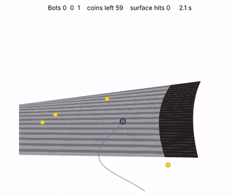
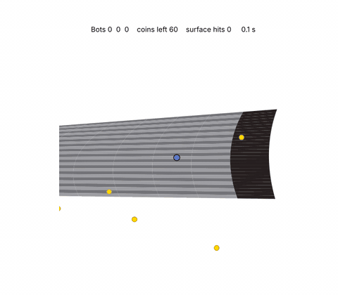

# `free-flight/` — Variation 2: free 3D flight over the strip, trained in PyTorch

In the 2016 simulation the cube rides on the Möbius strip. Here nothing holds the
bots to it. Each bot is a sphere that steers itself in 3D with a thrust vector,
the strip is a solid surface, and other bots are solid too. The policy has to:

- follow the strip, flying or driving along it (and stay within a corridor above it),
- collect the coins floating above it (a collected coin is gone),
- never touch the surface, and never touch another bot.



## How it learns

The simulator itself is written in PyTorch, so it is differentiable: the gradient
of the training loss flows back through the physics (thrust, drag, contact with
the surface, pushes between bots) and through the sensors into the network.
Training is backpropagation through time on 16 worlds with 4 bots each, cut every
25 steps (truncated BPTT), with Adam and a cosine learning-rate schedule.

The loss per step rewards progress along the strip and closing in on the nearest
coin, and penalises flying within 2.5 radii of the surface, coming within 4 radii
of another bot, leaving the corridor, and thrust (a small energy cost).

| | |
|---|---|
| Observation (23 numbers) | height above the strip, place across it, velocity in the strip's frame, the three nearest coins (position, present), the nearest bot (position, velocity) |
| Action | thrust across, up and forward, each in [-1, 1] |
| Network | 23 → 64 → 64 → 3, tanh |
| Body | radius 10; top speed 267 units/s (thrust 400, drag 1.5); strip radius 1000 |

## Results

Sixty seconds, 32 worlds with 4 bots each, the same seeds for every controller;
coins do not come back. Per bot and minute (`python evaluate.py`):

| Controller | Coins | Surface hits | Bot-bot hits | Speed along the strip | Time outside the corridor |
|---|---|---|---|---|---|
| untrained network | 0.0 | 1.87 | 0 | 37 | 73 % |
| hand-written cruise (maximum thrust ahead, hold 40 above the middle) | 0.7 | 0 | 0 | 259 | 0 % |
| **trained policy** (`models/flight_policy.pt`) | **4.1** | **0** | **0** | **271** | **0 %** |

The trained bots fly at top speed, collect about six times as many coins as the
hand-written cruise, and never touched the surface or each other in these runs.

## A transformer policy

`make_policy("transformer")` in `policy.py` returns `FlightTransformer` from
[`transformer/free-flight/`](../transformer/free-flight/): each of the bot's last 8 observations
is one token (a linear map to 32 numbers plus a learned position); two pre-norm
layers of 2-head self-attention and a GELU MLP follow, and the newest token gives
the thrust. 

The policy keeps this short memory itself; backpropagation runs
through it and through the simulator, cut at the same 25-step windows.

All three were trained 100 episodes with the same loss and seed. Sixty seconds,
32 worlds with 4 bots, seeds 7, 8 and 9, per bot and minute
(`transformer/free-flight/models/flight_transformer.eval.json`):

| Controller | Coins | Surface hits | Bot-bot hits | Speed along the strip |
|---|---|---|---|---|
| network 23 → 64 → 64 → 3 (`models/flight_policy.pt`) | 4.25 | 0 | 0 | 275 |
| transformer, memory of 1 observation (test only, not shipped) | 6.50 | 0 | 0 | 271 |
| **transformer, memory of 8** (`transformer/free-flight/models/flight_transformer.pt`) | **7.04** | **0** | **0** | **270** |

The transformer collects 66 % more coins than the network above, still without
touching the surface or another bot. The second row separates the two causes:
with a memory of a single observation it already reaches 6.50, so most of the
gain comes from the layers themselves, and the memory of 8 adds about 8 %.

## Run

```sh
pip install -r requirements.txt
python viewer.py demo                  # trained bots alone (window)
python viewer.py demo --bots 3 --save demo.mp4
python viewer.py compare               # add a bot you fly: W/S forward/back, A/D sideways, R/F up/down
python evaluate.py                     # the table above
python train.py --episodes 100         # train again (resumable: stop and rerun)
python viewer.py demo --policy ../transformer/free-flight/models/flight_transformer.pt --bots 3
python evaluate.py --policy ../transformer/free-flight/models/flight_transformer.pt
python train.py --kind transformer --episodes 100 --out ../transformer/free-flight/models/flight_transformer.pt
python -m pytest tests                 # includes a gradient check through the simulator
```

`tests/test_flight.py` checks the strip geometry and the closest-point projection,
that the surface is solid and collected coins vanish, and that the gradients
of a four-step rollout (policy → physics → loss) match finite differences
(`torch.autograd.gradcheck`). The transformer's own tests are in
`transformer/free-flight/`: its answer depends on its memory, and the gradient
reaches every weight.

## Files

```
mobius.py     the strip: position, tangents, frame, closest point (Gauss-Newton)
world.py      batched, differentiable physics: thrust, drag, solid surface, bot contacts, coins
policy.py     the network, and make_policy() for the MLP or the transformer
train.py      backpropagation through time
evaluate.py   trained against untrained, same seeds
viewer.py     demo and compare views (matplotlib, follow camera)
requirements.txt   torch, numpy, matplotlib
docs/         the demo clip
models/       the trained policy, its training history and evaluation
tests/        geometry, physics and gradient checks
```
