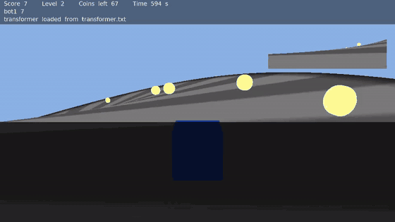
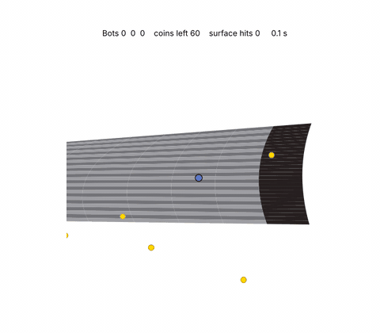

# `transformer/` — Transformer policies for both variations

Everything added in 2026 to replace the original networks with transformers is
collected here: the C++ forward pass the game runs, the PyTorch training code,
the trained models, the settings, the tests and the demo clips.

| Restored simulation: the bot cube | Free flight |
|---|---|
|  |  |
| attention over the last 4 camera frames | attention over the last 8 observations |
| 36.7 coins a round, against 21.8 for the original network | 7.04 coins per bot and minute, against 4.25 |

## Contents

| Path | |
|---|---|
| [`cpp/`](cpp/) | C++ forward pass of the cube transformer, compiled into the game |
| [`training/`](training/) | PyTorch: reads the game's recordings, trains, exports the weights |
| [`models/`](models/) | the trained transformer, the perceptron retrained on the same data, the results |
| [`config/`](config/) | settings to run, compare, evaluate and record |
| [`tests/`](tests/) | the check that C++ and PyTorch give the same outputs |
| [`free-flight/`](free-flight/) | the free-flight transformer, its tests and its trained model |
| [`docs/`](docs/) | the demo clips above |

## Quick start

```sh
# restored simulation (from the repository root, after building: see the main README)
./build/pai_sim transformer/config/demo.cfg       # the transformer drives
./build/pai_sim transformer/config/compare.cfg    # you beside it

# free flight
cd free-flight && pip install -r requirements.txt
python viewer.py demo --policy ../transformer/free-flight/models/flight_transformer.pt --bots 3
```

## Approach

**Restored simulation.** PyTorch trains the transformer, so no backpropagation is
written by hand. The weights are exported to a text file, and the C++ game runs
the forward pass alone, with no PyTorch needed to play. A unit test gives the C++
code and PyTorch the same weights and inputs; their outputs agree within
2.2 × 10⁻⁷. The game records its own camera frames with the autopilot's keys, so
the network learns from exactly the images it will see when it drives.

| | |
|---|---|
| Input | the last 4 camera frames, one every 0.05 s, each 20 x 20 grey pixels |
| Tokens | every 5 x 5 patch of every frame: 64 tokens, each with a learned position |
| Layers | 2 pre-norm layers: 2-head self-attention and a GELU MLP, width 32 |
| Output | layer norm, mean over the tokens, linear → 4 keys |
| Size | 20,164 parameters (the perceptron: 12,964) |

**Free flight.** The simulator is written in PyTorch and differentiable, so the
transformer trains exactly as the original network does: backpropagation through
the physics, cut every 25 steps. Each of the bot's last 8 observations is one
token; two pre-norm attention layers (2 heads, width 32) follow, and the newest
token gives the thrust.

## Data and training (restored simulation)

The rendered engine recorded the bot camera and the autopilot's key at every
decision (`config/record.cfg`): six runs, 346,165 frames, about 4.8 hours of
simulated driving, recorded at about 9 times real speed with a fixed time step.
The autopilot only steers, so as in 2016 the networks learn from the 75,216
frames where a key is pressed.

| Round | Recordings | Who drove (besides the autopilot) | Validation accuracy: perceptron / transformer |
|---|---|---|---|
| 0 | 2 runs | the shipped perceptron, 30 % of the time | 0.811 / 0.827 |
| 1 | + 2 runs | the transformer in one run, the perceptron in the other, 50 % each (DAgger) | 0.829 / 0.854 |
| 2 | + 2 runs | as round 1, with the round-1 networks | 0.825 / 0.852 |

After each round both networks were trained on all recordings so far, so they
always saw the same data. Validation accuracy is the share of held-out frames
where the network presses the autopilot's key.

## Results

### Restored simulation: every controller, seeds 101, 202, 303

A 90-second demo round in the rendered game: one bot, 74 coins that do not come back.

| Controller | 101 | 202 | 303 | Mean |
|---|---|---|---|---|
| untrained network | 0 | 0 | 2 | 0.7 |
| driving straight, never steering | 3 | 6 | 4 | 4.3 |
| perceptron learned in the game (`models/policy.txt`), first test | 26 | 17 | 28 | 23.7 |
| same perceptron, retested with the fixed time step | 29 | 19 | 24 | 24.0 |
| perceptron retrained in PyTorch, round 0 | 33 | 32 | 28 | 31.0 |
| perceptron retrained, round 1 | 32 | 42 | 32 | 35.3 |
| perceptron retrained, round 2 (`models/policy-same-data.txt`) | 33 | 41 | 33 | 35.7 |
| transformer, round 0 | 34 | 40 | 36 | 36.7 |
| transformer, round 1 | 33 | 42 | 40 | 38.3 |
| **transformer, round 2** (`models/transformer.txt`) | **36** | **36** | **37** | **36.3** |
| the autopilot it learned from, which sees every coin | 62 | 51 | 71 | 61.3 |

The first test of the original perceptron ran in real time; every later row ran
with a fixed step of 1/30 s, which gives the same result (23.7 and 24.0). The
straight and autopilot rows come from the same rules without rendering.
The retrained networks decide every 0.05 s, the rate they were trained at; the
original perceptron every 0.1 s, its own setting.

### Restored simulation: the shipped controllers, six seeds

| Controller | 101 | 202 | 303 | 404 | 505 | 606 | Mean |
|---|---|---|---|---|---|---|---|
| perceptron learned in the game, every 0.1 s | 29 | 19 | 24 | 19 | 21 | 19 | 21.8 |
| same perceptron, every 0.05 s | 12 | 19 | 15 | 7 | 28 | 15 | 16.0 |
| perceptron retrained on the recordings | 33 | 41 | 33 | 34 | 35 | 30 | 34.3 |
| **transformer** | **36** | **36** | **37** | **36** | **39** | **36** | **36.7** |

Most of the gain over the original perceptron comes from the recordings and the
DAgger rounds (21.8 → 34.3). On the same data the transformer adds 2.3 coins a
round (7 %): it wins on five of six seeds, varies least (36 to 39), and led in
every round, by the widest margin with the least data (round 0: 36.7 against 31.0).
The autopilot's 61.3 shows the room left.

### Free flight

Sixty seconds, 32 worlds with 4 bots each, seeds 7, 8 and 9; per bot and minute.
All learned policies trained 100 episodes with the same loss and seed.

| Controller | Coins | Surface hits | Bot-bot hits | Speed along the strip | Time outside the corridor |
|---|---|---|---|---|---|
| untrained network | 0.0 | 1.87 | 0 | 37 | 73 % |
| hand-written cruise (maximum thrust ahead) | 0.7 | 0 | 0 | 259 | 0 % |
| network 23 → 64 → 64 → 3 (`free-flight/models/flight_policy.pt`) | 4.25 | 0 | 0 | 275 | 0 % |
| transformer, memory of 1 observation (test only, not shipped) | 6.50 | 0 | 0 | 271 | 0 % |
| **transformer, memory of 8** (`free-flight/models/flight_transformer.pt`) | **7.04** | **0** | **0** | **270** | **0 %** |

The untrained and cruise rows are from seed 7 only. The transformer collects 66 %
more coins than the network, without touching the surface or another bot. With
a memory of a single observation it already reaches 6.50, so most of the gain
comes from the transformer layers, and the memory of 8 adds about 8 %.

## Reproduce

```sh
# restored simulation: record, train, export, check
./build/pai_sim transformer/config/record.cfg     # close the window to stop
python transformer/training/train.py --kind transformer --out transformer/models/transformer.txt transformer/recordings/*.bin
python transformer/training/train.py --kind mlp --out transformer/models/policy-same-data.txt transformer/recordings/*.bin
python transformer/training/make_fixture.py && ./build/pai_tests

# a DAgger round: add  policy_kind = transformer  to record.cfg, record, then train with
#   --init transformer/models/transformer.pt

# one evaluation round (add  seed = 101  to a copy of evaluate.cfg)
./build/pai_sim transformer/config/evaluate.cfg

# free flight
cd free-flight
python train.py --kind transformer --episodes 100 --out ../transformer/free-flight/models/flight_transformer.pt
python evaluate.py --policy ../transformer/free-flight/models/flight_transformer.pt
cd .. && python -m pytest transformer/free-flight
```
